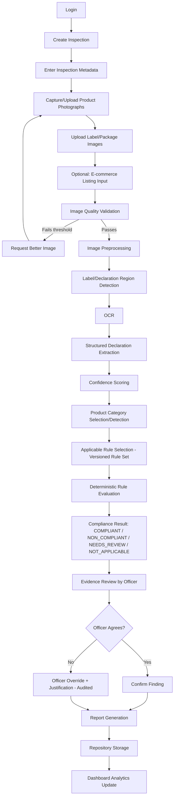
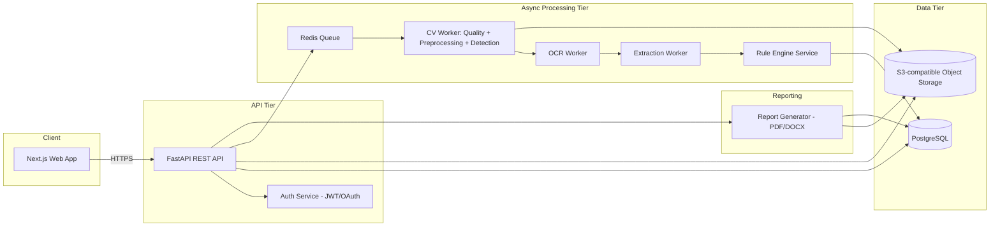
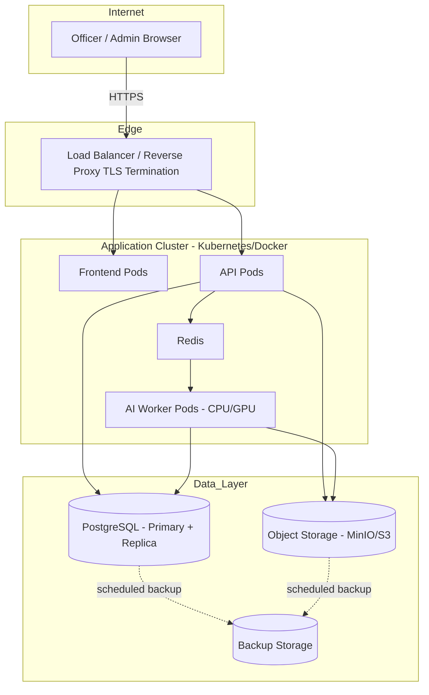
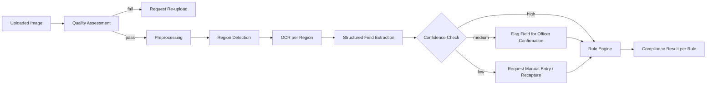
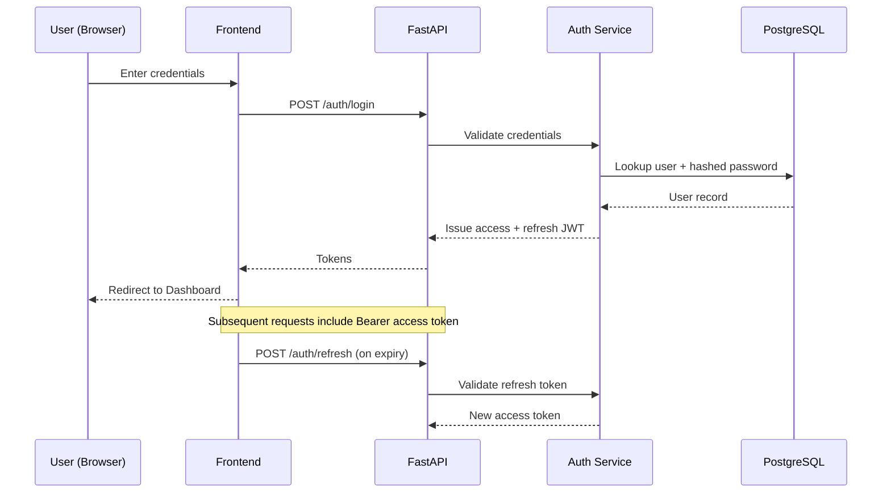
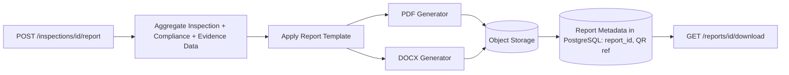

# Product Requirements Document
## Smart Legal Metrology Compliance Inspection Platform
**SIH Problem Statement ID: 26034** — *"Software System to check compliance of Packaged Commodities under Legal Metrology (Packaged Commodities) Rules, 2011 by scanning products, images and labels."*

| Document Control | |
|---|---|
| Version | 1.0 |
| Status | Draft for Implementation |
| Owner | Product/Engineering |
| Audience | Development team, enforcement stakeholders, evaluators |

---

## Legal Disclaimer & Classification of Statements

This PRD strictly separates four categories of statements, labeled throughout with tags:

| Tag | Meaning |
|---|---|
| **[LEGAL-VERIFIED]** | A requirement directly traceable to the Legal Metrology Act, 2009 / Legal Metrology (Packaged Commodities) Rules, 2011, or official Department of Consumer Affairs (DoCA) / India Code publications. Must be confirmed against the current, in-force text (including amendments) before being encoded in the rule engine. |
| **[SYSTEM-ASSUMPTION]** | A working assumption made for product design purposes, not itself a legal citation. |
| **[IMPLEMENTATION-DECISION]** | An engineering/architecture choice made by this PRD, not a legal requirement. |
| **[FUTURE-ENHANCEMENT]** | Out of scope for MVP; roadmap only. |

This PRD does **not** invent, paraphrase-as-fact, or guess at legal text. Any clause below referencing a specific declaration (MRP, net quantity, manufacturer/packer/importer name and address, consumer care details, month & year of manufacture, country of origin, dimensions, unit sale price) reflects the well-established categories of mandatory declarations under the Legal Metrology (Packaged Commodities) Rules, 2011 as commonly implemented, but **the engineering team and legal/compliance advisor must verify the exact, current rule text, thresholds, and applicability (including any amendments post-2011, e-commerce rules, and category-specific exemptions) against the official Legal Metrology Act 2009, the PC Rules 2011, and DoCA circulars before go-live.** Where this document is uncertain of an exact numeric threshold or applicability condition, it explicitly says so and defers to the "Needs Officer Review" outcome and to a legal-configuration step performed by the customer's legal/compliance team, rather than asserting a number.

---

## 1. Executive Summary

Legal Metrology enforcement in India today relies heavily on manual, paper-and-eyeball inspection of packaged commodities. An officer must physically read every mandatory declaration on a label — manufacturer/packer/importer details, net quantity, MRP, consumer care information, date of manufacture/import, country of origin, and unit sale price where applicable — cross-check it against the Legal Metrology Act, 2009 and the Legal Metrology (Packaged Commodities) Rules, 2011, and produce a report, all without any standardized digital evidence trail.

This PRD defines the **Smart Legal Metrology Compliance Inspection Platform (SLM-CIP)**: a web application that lets enforcement officers photograph a product and its label, runs the images through a computer-vision + OCR pipeline to extract structured declaration data with confidence scores and bounding-box evidence, and then evaluates that data against a **versioned, configurable, deterministic rule engine** encoding Legal Metrology requirements. The system never lets an LLM or opaque model "decide" legal compliance — AI's job is strictly to **extract evidence**; the **rule engine evaluates compliance** against that evidence, and every output that cannot be determined with confidence is routed to **Needs Officer Review** rather than guessed.

The platform produces evidence-linked PDF/DOCX reports, maintains a searchable inspection/product/violation repository, supports full role-based access control and immutable audit logging, and gives administrators dashboards for enforcement trend analysis (repeat offenders, violation categories, geography).

The MVP is scoped to be buildable and demonstrable within an SIH timeline while the full PRD defines a production-grade path to a real government deployment.

## 2. Problem Statement

### 2.1 Limitations of Manual Inspection

| Limitation | Description | Consequence |
|---|---|---|
| High inspection volume | Thousands of SKUs across retail, wholesale, and e-commerce channels | Officers cannot cover the market at sufficient scale |
| Manual label reading | Officers must read dense, small-print labels by eye | Slow, error-prone, fatiguing |
| Inconsistent inspection time | No standard checklist enforcement | Two officers may reach different conclusions on the same product |
| Missed declarations | Easy to overlook a missing mandatory field | Non-compliant products pass inspection |
| Formatting/readability issues | Font size, contrast, and placement rules are hard to assess by eye | Under- or over-enforcement |
| No centralized history | Inspection records are paper-based or siloed | No visibility into repeat violations by the same manufacturer |
| No standardized evidence-based reporting | Reports vary officer to officer | Weak legal defensibility, inconsistent escalation |
| Difficulty tracking repeat violations | No cross-inspection product/manufacturer linkage | Repeat offenders are not flagged systemically |

### 2.2 How the Platform Addresses These Issues

- **Speed & consistency**: OCR + structured extraction turns a label photo into machine-readable fields in seconds, and the same versioned rule set is applied identically to every inspection.
- **Completeness**: The rule engine explicitly evaluates every applicable mandatory declaration rule, so a missing field surfaces as a `NON_COMPLIANT` or `NEEDS_REVIEW` finding rather than being silently missed.
- **Evidence & auditability**: Every finding is linked to the exact image region, OCR text, and confidence score, and every officer action is logged immutably.
- **Centralized repository**: Products, manufacturers, and inspections become permanently searchable, enabling repeat-violation and manufacturer-risk analysis.
- **Standardized reporting**: Every inspection produces the same structured summary and detailed report format, suitable for legal escalation.

## 3. Objectives

1. Provide officers a fast, structured, evidence-based way to inspect packaged commodities for Legal Metrology compliance.
2. Extract label declarations via CV/OCR with confidence and bounding-box evidence — **never** as a final legal verdict.
3. Evaluate extracted evidence via a deterministic, versioned, configurable rule engine.
4. Route uncertain cases to `NEEDS_REVIEW` instead of forcing a binary pass/fail.
5. Preserve tamper-evident evidence and generate standardized, exportable compliance reports.
6. Maintain a searchable inspection/product/manufacturer repository with trend dashboards.
7. Enforce role-based access control and immutable audit logging throughout.

## 4. Scope

**In scope (see also Section 26, MVP Scope):**
- Web application for officer-initiated inspections (photo capture/upload, label images, optional e-commerce listing data)
- CV/OCR pipeline: image quality check → preprocessing → region detection → OCR → structured extraction → confidence scoring
- Deterministic, versioned Legal Metrology rule engine
- Evidence model, officer review/override workflow
- Summary + detailed compliance reports (PDF/DOCX export)
- Product/inspection/manufacturer repository with search/filter
- Dashboards (officer + admin)
- RBAC (Officer, Reviewer, Department Admin, System Admin)
- Immutable audit logging
- REST API layer, PostgreSQL data model, containerized deployment

**Out of scope for MVP** (see Section 27, Future Enhancements):
- Native mobile app, offline mode
- Automated e-commerce web crawling (only manual/pasted listing data in MVP)
- Multilingual UI (OCR supports multiple languages; UI is English-first)
- Manufacturer risk-scoring models, anomaly detection
- Integration with external government IT systems
- National/state-level aggregated dashboards across multiple deployments

## 5. Non-Goals

- The system is **not** a consumer-facing app and is **not** designed for shopping/price-comparison use cases.
- The system does **not** allow an LLM to autonomously declare legal compliance or non-compliance; all legal determinations trace to the deterministic rule engine acting on extracted evidence, or to `NEEDS_REVIEW` for a human officer.
- The system does **not** claim millimetre-precise physical font-size measurement without calibration (Section 9).
- The system does **not** replace legal advice or a court/tribunal's final determination — it produces enforcement-support evidence and preliminary findings for officer confirmation.


## 6. User Personas & Permissions

### 6.1 Enforcement Officer
- **Goals**: Conduct field/desk inspections quickly, capture reliable evidence, produce defensible reports.
- **Permissions**: Create/edit own inspections, upload images, run analysis, confirm/override findings on own inspections, generate reports, view own inspection history.
- **Workflows**: Full core user journey (Section 7) for inspections they own.
- **Dashboards**: Personal inspection stats, pending reviews on own cases, recent violations.
- **Approval/review capability**: Can request Reviewer sign-off; cannot approve their own escalated/high-severity findings.

### 6.2 Reviewer / Senior Officer
- **Goals**: Quality-check officer findings, approve/reject escalated or high-severity cases, ensure consistency across officers.
- **Permissions**: View all inspections in jurisdiction, approve/reject officer findings and overrides, add reviewer remarks, request re-inspection.
- **Workflows**: Review queue → open inspection → inspect evidence → approve/reject/annotate → sign off report.
- **Dashboards**: Team-wide pending reviews, override rate by officer, violation trend by category.
- **Approval capability**: Final sign-off on reports before external release; can override an officer's override with justification (fully audited).

### 6.3 Department Administrator
- **Goals**: Manage users/roles for their department, configure rule applicability at a department/jurisdiction level, monitor department KPIs.
- **Permissions**: User management (within department), view all department reports, manage rule *activation* (not authoring) within permitted scope, view audit logs (department-scoped).
- **Workflows**: Onboard officers, assign jurisdictions, monitor dashboards, escalate systemic issues.
- **Dashboards**: Department-wide compliance rates, manufacturer trends, geographic trends, inspection throughput.

### 6.4 System Administrator
- **Goals**: Maintain platform health, manage the legal rule engine's rule authoring/versioning, manage global RBAC, ensure security/compliance of the platform itself.
- **Permissions**: Full rule CRUD + versioning + publishing, global user/role management, full audit-log access, system configuration, integration management.
- **Workflows**: Author/version rules with legal_reference and effective dates, publish rule versions, manage global settings, respond to security/audit events.
- **Dashboards**: System health, rule version history, global usage metrics, audit log explorer.

### 6.5 RBAC Summary Table

| Capability | Officer | Reviewer | Dept Admin | Sys Admin |
|---|---|---|---|---|
| Create inspection | ✅ | ✅ | ❌ | ❌ |
| Upload images | ✅ | ✅ | ❌ | ❌ |
| Run AI analysis | ✅ | ✅ | ❌ | ❌ |
| Override finding (own case) | ✅ (audited) | ✅ | ❌ | ❌ |
| Approve/reject escalations | ❌ | ✅ | ✅ (dept) | ✅ |
| Generate/download report | ✅ (own) | ✅ | ✅ (dept) | ✅ |
| View all dept inspections | ❌ | ✅ | ✅ | ✅ |
| Manage users | ❌ | ❌ | ✅ (dept) | ✅ (global) |
| Author/publish rules | ❌ | ❌ | ❌ (activate only) | ✅ |
| View audit logs | ❌ (own actions only) | Partial (team) | ✅ (dept) | ✅ (global) |

## 7. Core User Journey (End-to-End Workflow)



Each step is independently testable and logged. Steps G, L, and O are the three points where the system may branch to a human-required state (bad image, low-confidence extraction, or ambiguous rule applicability) rather than silently proceeding.

## 8. Input Types

### 8.1 Physical Product Images
- Front, back, side, top/bottom views
- Close-up label images
- Multiple images per package (system must associate all images with one inspection/product instance)
- Minimum resolution and format validated at upload (Section 9.A)

### 8.2 Label Images
- Cropped label images (officer pre-crops in field)
- Full photographs containing the printed declaration block (system detects the region, Section 9.C)

### 8.3 E-commerce Listing Input (MVP: manual entry/paste; Phase 2: URL fetch)
| Field | Notes |
|---|---|
| Product title | Free text |
| Description | Free text |
| Manufacturer | Compared against extracted label value |
| Packer | Compared against extracted label value |
| Importer | Compared against extracted label value, if applicable |
| MRP | Compared against extracted label value |
| Net quantity | Compared against extracted label value |
| Consumer care information | Compared against extracted label value |
| Country of origin | Compared against extracted label value |
| Product images | Optionally OCR'd like uploaded images |
| Listing URL | Stored as reference; **[IMPLEMENTATION-DECISION]** MVP does not auto-crawl; officer pastes fields manually or uploads a screenshot |

Discrepancies between e-commerce listing data and physical-label extracted data are flagged as a distinct finding category ("Listing/Label Mismatch") — routed to `NEEDS_REVIEW`, not auto-failed, since listing staleness is common and not itself proof of a labeling violation.


## 9. AI / Computer Vision Pipeline

**Guiding principle:** every stage below is an independently testable, independently evaluable microservice/module. No stage is allowed to silently swallow uncertainty — each stage emits a confidence/quality signal that downstream stages and the UI must surface.

### 9.A Image Quality Assessment
Detects, per uploaded image:
- Blur (Laplacian-variance or learned blur classifier)
- Low resolution (below configurable minimum px thresholds for label legibility)
- Excessive glare (specular highlight detection)
- Extreme rotation/skew
- Occlusion (fingers, objects covering label)
- Poor contrast
- General "insufficient quality" composite score

**Output**: `{quality_score, issues: [...], pass: bool}`. If `pass=false`, the UI must prompt the officer to retake/re-upload before analysis proceeds (workflow step G1). Officers may force-proceed with a low-quality image, but the system must permanently flag the resulting evidence and any dependent findings as `NEEDS_REVIEW` — the override is allowed, the risk is never hidden.

### 9.B Image Preprocessing
- Denoising
- Perspective correction (deskew a photographed label back to a flat rectangle)
- Rotation correction
- Contrast enhancement
- Cropping to region of interest
- Resizing to model input requirements

Both the **original** and **processed** image are retained (Section 12, Evidence Model) — processing must never overwrite/destroy the original evidence.

### 9.C Declaration / Label Region Detection
Object-detection model identifies semantic regions:
- Manufacturer information
- Packer information
- Importer information
- Net quantity
- MRP
- Date declaration (manufacture/import/packing month & year)
- Consumer care information
- Country of origin
- Other declaration blocks (e.g., unit sale price, dimensions, best-before)

**[IMPLEMENTATION-DECISION]** Architecture supports YOLO-family or RT-DETR-family detectors behind a common interface (`DetectionModel.predict(image) -> List[Region(label, bbox, confidence)]`), so the specific model can be swapped/upgraded without touching downstream code.

### 9.D OCR
- Supports English, Hindi, and other Indian languages where feasible (extensible language pack architecture)
- Handles numerals, currency symbols (₹), and mixed-script text
- Every OCR result retains: `text`, `confidence`, `bounding_box`, `source_image_reference`

**[IMPLEMENTATION-DECISION]** PaddleOCR (or an equivalent open, multilingual OCR engine) is the baseline; the OCR interface is abstracted so engines can be swapped/ensembled per language.

### 9.E Information Extraction
Converts raw OCR spans into structured, typed fields via a combination of region-detection context (9.C) and rule-based/NER-style field parsing (e.g., normalizing "₹120.00" and "Rs. 120" to a canonical MRP value; normalizing "500 g" / "0.5 kg" to a canonical net-quantity value + unit).

Example structured output:
```json
{
  "mrp": {
    "value": "₹120.00",
    "normalized_value": 120.00,
    "currency": "INR",
    "confidence": 0.98,
    "bbox": [x1, y1, x2, y2],
    "source_image_id": "img_00231"
  },
  "net_quantity": {
    "value": "500 g",
    "normalized_value": 500,
    "unit": "g",
    "confidence": 0.99,
    "bbox": [x1, y1, x2, y2],
    "source_image_id": "img_00231"
  }
}
```

### 9.F OCR Uncertainty Handling

| Confidence band | Behavior |
|---|---|
| High (≥ configurable threshold, e.g. 0.90) | Automatic downstream processing by rule engine |
| Medium (e.g. 0.60–0.90) | Field flagged for officer confirmation before rule evaluation finalizes; rule result becomes `NEEDS_REVIEW` if unconfirmed |
| Low (< e.g. 0.60) | Field marked "not reliably extracted"; officer prompted to re-capture image or enter value manually; never silently defaulted |

**[SYSTEM-ASSUMPTION]** Exact numeric thresholds (0.90/0.60 above) are illustrative defaults, configurable per deployment and per field type, and must be tuned against the evaluation dataset (Section 24–25) before production use.

## 10. Legal Rule Engine

### 10.1 Design Principle
**"AI extracts evidence; a deterministic rule engine evaluates compliance."** The rule engine is a transparent, versioned, auditable component — not a black box and not an LLM. Given a set of extracted fields (with confidence/evidence) and a product category, it evaluates each applicable rule and returns one of four explicit states.

### 10.2 Rule Schema

| Field | Type | Description |
|---|---|---|
| `rule_id` | string | Stable unique identifier |
| `rule_version` | string/int | Version of this specific rule's logic |
| `legal_reference` | string | Citation to Act/Rule/Section/Notification — **[LEGAL-VERIFIED]** must map to actual, current legal text, confirmed by the legal/compliance owner before publishing |
| `requirement` | string | Human-readable statement of the requirement |
| `applicability_conditions` | structured expression | e.g., product category, package type, import status, exemption flags |
| `input_fields` | list | Which extracted fields this rule consumes |
| `validation_logic` | structured expression / code reference | Deterministic evaluation logic |
| `severity` | enum | e.g., Critical / Major / Minor |
| `evidence_requirements` | list | What evidence must be attached to a finding under this rule |
| `explanation_template` | string | Template used to render a human-readable explanation of the result |
| `active_from` | date | Effective start date |
| `active_until` | date/null | Effective end date, null if still active |
| `source_document` | string/URI | Official document this rule derives from |

### 10.3 Rule Engine Capabilities
- Mandatory declaration presence checks
- Missing declaration detection
- Formatting validation (e.g., presence of required units, currency symbol placement)
- Value validation (e.g., MRP present, non-zero, correctly formatted)
- Category applicability logic (a rule may not apply to certain exempted categories/package types)
- Readability checks (delegates to Section 11 font-size/readability modes)
- Conditional/composite rules (e.g., "if imported, then country-of-origin AND importer details required")
- Full rule versioning: historical inspections always re-render against the rule version active at inspection time, not the latest version
- Auditability: every rule publish/edit is logged with author, timestamp, and diff

### 10.4 Result States

| State | Meaning |
|---|---|
| `COMPLIANT` | Rule's condition is satisfied with sufficient-confidence evidence |
| `NON_COMPLIANT` | Rule's condition is violated with sufficient-confidence evidence |
| `NEEDS_REVIEW` | Evidence is insufficient/low-confidence/ambiguous applicability — **never** forced to a binary result |
| `NOT_APPLICABLE` | Rule's applicability_conditions are not met for this product/package |

The engine must never emit a bare pass/fail where evidence is insufficient — `NEEDS_REVIEW` exists precisely to prevent unsupported legal conclusions, consistent with the product's core legal-safety principle (Section "Legal and Regulatory Scope": *"Needs Officer Review" rather than an unsupported legal conclusion*).

### 10.5 Versioning & Change Management
Because the Legal Metrology (Packaged Commodities) Rules, 2011 are subject to amendments, notifications, and category-specific clarifications, the rule engine must:
1. Never allow silent overwrite of a live rule — every change creates a new `rule_version`.
2. Require a System Administrator (with a documented `legal_reference` and `source_document`) to publish a new version.
3. Bind every historical inspection's compliance result to the rule version that was active at inspection time (immutability for audit/legal defensibility).
4. Support a staged rollout: `draft → under legal review → published → active → superseded/deprecated`.


## 11. Font Size and Readability

**[SYSTEM-ASSUMPTION — explicitly acknowledged limitation]** Physical font size (e.g., a millimetre height requirement) **cannot be reliably inferred from pixel dimensions alone**, because pixel-to-millimetre conversion depends on camera distance, sensor, zoom, and perspective, none of which are known without a reference. The system must never claim a millimetre-level physical measurement without calibration, and the UI/reports must state this limitation explicitly wherever font-size-related findings appear.

Three supported modes:

### Mode A — Calibrated
Officer enters a known physical package dimension (e.g., package height in mm) at capture time; the system computes a pixel-to-mm ratio for that specific image and can then estimate character heights in physical units with a stated margin of error.

### Mode B — Reference Object
The image contains an object of known physical size (e.g., a printed calibration card, ruler, or standard coin) that the system detects to derive the pixel-to-mm ratio automatically.

### Mode C — Visual Readability (no calibration; default mode)
When neither A nor B is available, the system evaluates *relative* readability using:
- OCR confidence
- Character height in pixels relative to the image/label region
- Contrast
- Blur
- Obstruction
- Skew
- Background interference

Mode C explicitly produces a **readability assessment**, not a millimetre measurement, and any resulting finding is labeled `NEEDS_REVIEW` if it would otherwise require a specific legal minimum font size that cannot be verified without calibration.

| Mode | Output | Legal Weight |
|---|---|---|
| A: Calibrated | Estimated mm height ± error margin | Usable as supporting evidence for a specific numeric rule, subject to officer confirmation |
| B: Reference Object | Estimated mm height ± error margin | Same as A |
| C: Visual Readability | Qualitative readability score (e.g., Poor/Fair/Good) | Cannot alone support a specific mm-based finding; routes to `NEEDS_REVIEW` if a numeric threshold rule applies |

## 12. Evidence Model

Every compliance finding must be traceable to concrete evidence. Stored per finding:

- Original image (untouched, immutable)
- Processed image (denoised/corrected version used for extraction)
- Cropped region image (the specific detected declaration block)
- Bounding box coordinates
- OCR text
- OCR confidence
- Applied rule (`rule_id` + `rule_version`)
- System result (`COMPLIANT` / `NON_COMPLIANT` / `NEEDS_REVIEW` / `NOT_APPLICABLE`)
- Officer decision (confirm / override + justification)
- Timestamp
- User ID (of uploader, analyzer, and reviewing officer)

**UX requirement**: clicking any violation in the UI must open a viewer showing the exact image region (via bounding box overlay on the original image) that supports the finding, alongside the OCR text and confidence.

**Immutability rule**: original evidence is never deleted or overwritten when an officer edits/corrects a field — corrections are stored as new officer-decision records layered on top of, not replacing, the original AI output and image.

## 13. Compliance Report

### 13.1 Summary Report
| Field | Description |
|---|---|
| Inspection ID | Unique identifier |
| Product details | Name, category, manufacturer, images |
| Inspection date | Timestamp |
| Officer | Name/ID of inspecting officer |
| Compliance status | Overall COMPLIANT / NON_COMPLIANT / NEEDS_REVIEW |
| Major violations | List of Critical/Major severity findings |
| Number of violations | Count by severity |
| Overall result | Final officer-confirmed determination |
| Reviewer remarks | If reviewed |

### 13.2 Detailed Report

| Rule | Requirement | Detected Value | Result | Confidence | Evidence |
|---|---|---|---|---|---|
| `rule_id` | Human-readable requirement text | Extracted field value (or "not found") | COMPLIANT/NON_COMPLIANT/NEEDS_REVIEW/NOT_APPLICABLE | 0.0–1.0 | Link/thumbnail to cropped evidence image |

- Includes supporting images with highlighted (bounding-boxed) violations.
- Clearly distinguishes: **automated findings**, **officer-confirmed findings**, and **officer overrides** (each visually and textually labeled distinctly, never merged into a single unlabeled "result").
- Export formats: **PDF** and **editable DOCX**.
- Each report has a unique Report ID and a QR code / reference code enabling later verification lookup (Phase 2: public verification endpoint).

## 14. Product & Inspection Repository

Searchable storage across:
- Products
- Inspections
- Manufacturers
- Images
- Declarations (extracted fields)
- Violations
- Reports
- Officer decisions

**Search/filter facets:**
Product name · Manufacturer · Inspection ID · Date (range) · Category · Compliance state · Violation type · Officer · Location · MRP (range) · Net quantity (range)

This repository is the backbone for repeat-violation and manufacturer-trend analytics in Section 15.

## 15. Dashboard

Dashboards prioritize **actionable enforcement information**, not vanity charts.

**Officer dashboard:**
- Own pending inspections / drafts
- Own pending reviews
- Recent violations found
- Personal inspection throughput

**Admin / Reviewer dashboard:**
- Total inspections (by period)
- Compliant vs. non-compliant vs. needs-review counts
- Top violation categories (ranked, drill-down capable)
- Violation trends over time
- Product category breakdown
- Manufacturer trends (which manufacturers/packers repeat-offend)
- Geographical trends (where location metadata is captured)
- Pending reviews queue (age-sorted, so nothing silently stalls)
- Inspection activity (by officer, by department)
- **Repeat violations** — same manufacturer/product flagged for the same `rule_id` across multiple inspections, explicitly surfaced as an actionable list, not buried in a chart

Every dashboard widget must support drill-down to the underlying inspection list — no dead-end visualizations.


## 16. Auditability

Every significant action is logged to an **immutable** audit trail (application-level immutability: no UPDATE/DELETE permitted on audit records; append-only table, optionally backed by write-once storage or cryptographic chaining in later phases).

Audited actions include:
- Login (success/failure)
- Image upload
- Inspection creation
- Extraction run (model version used, inputs, outputs)
- Rule evaluation run (rule versions applied)
- Officer modification of any extracted field
- Officer override of a system finding (with mandatory justification text)
- Report generation
- Report download
- Rule creation/edit/publish
- User/role changes

Each audit record includes: actor (`user_id`), action type, target entity, before/after values (where applicable), timestamp, and IP/session metadata.

## 17. Security

- **Encrypted transport**: TLS everywhere (HTTPS, HSTS enabled).
- **Secure authentication**: JWT-based sessions with short-lived access tokens + refresh tokens; OAuth-compatible architecture for future SSO/government identity integration.
- **Password hashing**: bcrypt/argon2 with per-user salt.
- **Role-based authorization**: enforced server-side on every endpoint (never trust client-side role checks alone).
- **Object-storage access controls**: pre-signed, time-limited URLs for image/report access; no public bucket access.
- **Rate limiting**: per-user and per-IP limits on auth and analysis endpoints.
- **Upload validation**: strict file-type/magic-byte validation, size limits, and re-encoding of images server-side to strip embedded scripts/EXIF-based attack vectors.
- **Malware-safe file handling**: uploaded files scanned before being persisted to durable storage; processing occurs in a sandboxed worker.
- **Audit logging**: as per Section 16, applied to all security-relevant events.
- **Secrets management**: environment/secret-manager-based (e.g., Vault/cloud secret manager) — never hardcoded or committed.
- **Backup & recovery**: automated encrypted backups of database and object storage, with defined RPO/RTO (Section 18).
- **Privacy controls**: officer/user PII access scoped by role; data retention policy defined per deployment/government requirement.

## 18. Non-Functional Requirements

| Category | Requirement (target) |
|---|---|
| Image upload | ≤ 3s for a single image up to 10MB on standard broadband/4G |
| OCR extraction | ≤ 8s per image (async job; UI shows progress, never blocks) |
| Rule evaluation | ≤ 1s per inspection (deterministic engine, no external calls) |
| Complete report generation | ≤ 5s for PDF, ≤ 8s for DOCX, for a typical 10–15 rule inspection |
| API latency (non-AI endpoints) | p95 < 300ms |
| Uptime | 99.5% for production deployment |
| Scalability | Horizontally scalable AI workers (queue-based); target 10,000 inspections/day at full deployment |
| Security | Pass OWASP ASVS L2-equivalent review before go-live |
| Usability | Officer can complete a full inspection (upload → result) in ≤ 5 minutes for a standard product |
| Maintainability | Rule changes require no code deployment (config/data-driven) |
| Observability | Structured logs, metrics (latency, queue depth, model confidence distributions), and alerting on pipeline failures |
| Recoverability | RPO ≤ 1 hour, RTO ≤ 4 hours for production database/object storage |

## 19. AI Evaluation Strategy

**No single "AI accuracy" number is used.** Metrics are tracked independently per pipeline stage:

**OCR:**
- Character accuracy (CER)
- Word accuracy (WER)
- Field-level extraction accuracy (does the structured field match ground truth, post-normalization)

**Object detection (region detection):**
- Precision
- Recall
- mAP (mean average precision) per region class (MRP, net quantity, manufacturer, etc.)

**Compliance (rule engine output vs. ground-truth legal determination on the eval set):**
- Precision of violation detection
- Recall of violation detection
- False-positive rate (flagging compliant products as violations)
- False-negative rate (missing real violations)

**Human review:**
- Reviewer agreement rate (how often Reviewer confirms Officer's confirmed finding)
- Override rate (how often officers override AI-suggested findings, tracked per rule and per officer to catch systematic model weaknesses or, conversely, officer inconsistency)

Each metric is tracked per model/rule version and regressed against on every release.

## 20. Dataset Strategy

**Composition:**
- Compliant packages (positive examples across categories)
- Intentionally non-compliant examples (missing/incorrect declarations, seeded synthetically and/or sourced from real flagged cases with consent/anonymization)
- Low-quality photographs (blur, glare, poor lighting — deliberately included, not filtered out, since these are common field conditions)
- Varied lighting conditions
- Varied packaging materials (plastic, foil, glass, cardboard — different OCR difficulty profiles)
- Varied fonts/typefaces
- Multilingual labels (English + Hindi + regional languages where feasible)
- Multiple product categories (food, cosmetics, household, electronics, etc., since applicability rules differ by category)

**Annotation strategy:**
- Bounding-box labels for each declaration region (for the detector, Section 9.C)
- OCR ground truth (verified transcription per region)
- Compliance ground truth (a legal/compliance-reviewed label of COMPLIANT/NON_COMPLIANT/NOT_APPLICABLE per rule per sample, produced by domain experts, not by the model itself)

**Splits & augmentation:**
- Train/validation/test split, stratified by category and by compliance status, to avoid leakage and to ensure rare violation types are represented in test
- Data augmentation: rotation, blur, brightness/contrast jitter, synthetic glare, perspective warps — to make the CV pipeline robust to real field-capture conditions

**Privacy considerations:**
- Manufacturer/brand data is generally public-facing (label content), but any incidentally captured personal data (e.g., a bystander in a photo) must be redacted/blurred before dataset inclusion; dataset access is role-restricted and subject to the deployment's data-retention/privacy policy.


## 21. Technology Architecture & Rationale

| Layer | Technology | Why |
|---|---|---|
| Frontend | Next.js, React, TypeScript, Tailwind CSS | SSR/SPA hybrid suits a dashboard-heavy enforcement UI; TypeScript reduces runtime errors in a compliance-critical UI; Tailwind speeds up building the many structured screens (Section 23) consistently |
| Backend API | Python, FastAPI | Python is the natural fit alongside the CV/OCR stack (shared language, easy model integration); FastAPI gives async I/O for handling long-running AI jobs plus auto-generated OpenAPI docs for the API surface in Section 22 |
| AI/CV | OpenCV, YOLO/RT-DETR, PaddleOCR (or equivalent), PyTorch | OpenCV for classical preprocessing (Section 9.B); YOLO/RT-DETR for real-time-capable region detection; PaddleOCR for strong multilingual (incl. Indic-language) OCR support; PyTorch as the common training/inference framework across custom models |
| Database | PostgreSQL | Strong relational integrity for the rule/versioning/audit model (Section 24), JSONB support for flexible structured-field storage, mature and government-deployment-friendly |
| Object Storage | S3-compatible storage / MinIO | Needed for large volumes of original + processed images and reports; MinIO allows on-premises/government-cloud deployment where public cloud is restricted |
| Background Processing | Redis + Celery (or equivalent) | AI pipeline stages (Section 9) are inherently async/long-running; a queue decouples upload from processing and allows horizontal scaling of GPU/CPU workers independent of the API tier |
| Authentication | JWT / OAuth-compatible | Stateless, scalable auth; OAuth-compatibility leaves the door open for future integration with a government SSO/identity provider |
| Report Generation | PDF + DOCX generation libraries (e.g., WeasyPrint/ReportLab for PDF; python-docx for DOCX) | Matches the two mandated export formats (Section 13) |
| Containerization | Docker (+ Docker Compose for dev, Kubernetes-ready for production) | Consistent environments across dev/SIH-demo/production; enables independent scaling of API vs. AI worker tiers |

## 22. System Architecture

### 22.1 Logical Architecture



### 22.2 Deployment Architecture



### 22.3 AI Pipeline Data Flow



### 22.4 Authentication Flow



### 22.5 Reporting Architecture




## 23. API Specification

All endpoints require a valid Bearer JWT except `/auth/login`. All mutating endpoints are RBAC-checked server-side (Section 6.5) and audit-logged (Section 16).

### Authentication
| Method | Endpoint | Description |
|---|---|---|
| POST | `/auth/login` | Authenticate, returns access + refresh tokens |
| POST | `/auth/refresh` | Exchange refresh token for new access token |

### Inspections
| Method | Endpoint | Description |
|---|---|---|
| POST | `/inspections` | Create a new inspection (metadata: product name/category, location, date) |
| GET | `/inspections` | List/search inspections (filters per Section 14) |
| GET | `/inspections/{id}` | Get full inspection detail |
| PATCH | `/inspections/{id}` | Update inspection metadata / status |

### Images
| Method | Endpoint | Description |
|---|---|---|
| POST | `/inspections/{id}/images` | Upload one or more images to an inspection |
| GET | `/inspections/{id}/images` | List images for an inspection |

### Analysis
| Method | Endpoint | Description |
|---|---|---|
| POST | `/inspections/{id}/analyze` | Trigger the async AI pipeline (quality → preprocessing → detection → OCR → extraction) |
| GET | `/inspections/{id}/analysis` | Get analysis status/results (polling or webhook-notified) |

### Compliance
| Method | Endpoint | Description |
|---|---|---|
| GET | `/inspections/{id}/compliance` | Get rule engine results for the inspection |
| PATCH | `/compliance/{id}/review` | Officer/Reviewer confirms or overrides a specific finding (requires justification on override) |

### Rules
| Method | Endpoint | Description |
|---|---|---|
| GET | `/rules` | List rules (filter by category, active status, version) |
| POST | `/rules` | Create a new rule (draft state) — System Admin only |
| PATCH | `/rules/{id}` | Edit/publish a rule version — System Admin only |

### Reports
| Method | Endpoint | Description |
|---|---|---|
| POST | `/inspections/{id}/report` | Generate summary + detailed report (PDF + DOCX) |
| GET | `/reports/{id}` | Get report metadata |
| GET | `/reports/{id}/download` | Download report file |

### Dashboard
| Method | Endpoint | Description |
|---|---|---|
| GET | `/dashboard/summary` | Aggregate counts (compliant/non-compliant/needs-review, totals) |
| GET | `/dashboard/violations` | Top violation categories, breakdowns |
| GET | `/dashboard/trends` | Time-series trend data |

**Additional endpoints implied by RBAC/audit requirements (recommended, not in original list but necessary for a complete implementation):**
| Method | Endpoint | Description |
|---|---|---|
| GET/POST/PATCH | `/users` | User management (Dept Admin/Sys Admin scoped) |
| GET | `/audit-logs` | Audit log query (scope-restricted per role) |
| GET | `/products` / `/manufacturers` | Repository search (Section 14) |

## 24. Database Schema

All tables include `created_at`, `updated_at` timestamps unless noted. Primary keys are UUIDs unless noted.

```sql
-- Identity & Access
users (
  id UUID PK,
  username VARCHAR UNIQUE,
  email VARCHAR UNIQUE,
  password_hash VARCHAR,
  role_id UUID FK -> roles.id,
  department_id UUID,
  status VARCHAR, -- active/disabled
  created_at, updated_at
)

roles (
  id UUID PK,
  name VARCHAR UNIQUE, -- Officer, Reviewer, DeptAdmin, SysAdmin
  description TEXT
)

permissions (
  id UUID PK,
  code VARCHAR UNIQUE, -- e.g. 'inspection.create'
  description TEXT
)

role_permissions (
  role_id UUID FK -> roles.id,
  permission_id UUID FK -> permissions.id,
  PRIMARY KEY (role_id, permission_id)
)

-- Core Domain
products (
  id UUID PK,
  name VARCHAR,
  category VARCHAR,
  manufacturer_id UUID FK -> manufacturers.id,
  created_at, updated_at
)

manufacturers (
  id UUID PK,
  name VARCHAR,
  address TEXT,
  gstin VARCHAR NULL,
  risk_flag BOOLEAN DEFAULT false,
  created_at, updated_at
)

inspections (
  id UUID PK,
  product_id UUID FK -> products.id NULL, -- may be created before product match resolved
  officer_id UUID FK -> users.id,
  reviewer_id UUID FK -> users.id NULL,
  status VARCHAR, -- draft/analyzing/needs_review/completed/reported
  location VARCHAR NULL,
  overall_result VARCHAR, -- COMPLIANT/NON_COMPLIANT/NEEDS_REVIEW
  inspection_date TIMESTAMP,
  created_at, updated_at,
  INDEX idx_inspections_status (status),
  INDEX idx_inspections_officer (officer_id),
  INDEX idx_inspections_date (inspection_date)
)

product_images (
  id UUID PK,
  inspection_id UUID FK -> inspections.id,
  image_type VARCHAR, -- front/back/side/label/ecommerce
  original_uri VARCHAR,
  processed_uri VARCHAR NULL,
  quality_score FLOAT NULL,
  quality_issues JSONB NULL,
  uploaded_by UUID FK -> users.id,
  created_at,
  INDEX idx_images_inspection (inspection_id)
)

detected_regions (
  id UUID PK,
  image_id UUID FK -> product_images.id,
  region_type VARCHAR, -- mrp/net_quantity/manufacturer/etc.
  bbox JSONB, -- [x1,y1,x2,y2]
  confidence FLOAT,
  model_version VARCHAR,
  created_at,
  INDEX idx_regions_image (image_id)
)

ocr_results (
  id UUID PK,
  region_id UUID FK -> detected_regions.id,
  text TEXT,
  confidence FLOAT,
  bbox JSONB,
  language VARCHAR,
  created_at,
  INDEX idx_ocr_region (region_id)
)

extracted_fields (
  id UUID PK,
  inspection_id UUID FK -> inspections.id,
  field_name VARCHAR, -- mrp/net_quantity/manufacturer_name/etc.
  raw_value VARCHAR,
  normalized_value JSONB NULL,
  confidence FLOAT,
  source_ocr_id UUID FK -> ocr_results.id NULL,
  officer_confirmed BOOLEAN DEFAULT false,
  officer_corrected_value JSONB NULL,
  created_at, updated_at,
  INDEX idx_fields_inspection (inspection_id),
  INDEX idx_fields_name (field_name)
)

-- Rule Engine
rules (
  id UUID PK,
  rule_key VARCHAR, -- stable business key across versions
  legal_reference VARCHAR,
  requirement TEXT,
  severity VARCHAR,
  source_document VARCHAR,
  created_by UUID FK -> users.id,
  created_at, updated_at
)

rule_versions (
  id UUID PK,
  rule_id UUID FK -> rules.id,
  version INT,
  applicability_conditions JSONB,
  input_fields JSONB,
  validation_logic JSONB, -- structured expression
  evidence_requirements JSONB,
  explanation_template TEXT,
  active_from DATE,
  active_until DATE NULL,
  status VARCHAR, -- draft/published/superseded
  published_by UUID FK -> users.id NULL,
  created_at,
  INDEX idx_rule_versions_rule (rule_id),
  INDEX idx_rule_versions_active (active_from, active_until)
)

compliance_checks (
  id UUID PK,
  inspection_id UUID FK -> inspections.id,
  rule_version_id UUID FK -> rule_versions.id,
  result VARCHAR, -- COMPLIANT/NON_COMPLIANT/NEEDS_REVIEW/NOT_APPLICABLE
  confidence FLOAT NULL,
  system_generated BOOLEAN DEFAULT true,
  officer_decision VARCHAR NULL, -- confirmed/overridden
  officer_id UUID FK -> users.id NULL,
  override_justification TEXT NULL,
  created_at, updated_at,
  INDEX idx_checks_inspection (inspection_id),
  INDEX idx_checks_rule_version (rule_version_id),
  INDEX idx_checks_result (result)
)

violations (
  id UUID PK,
  compliance_check_id UUID FK -> compliance_checks.id,
  severity VARCHAR,
  description TEXT,
  created_at,
  INDEX idx_violations_check (compliance_check_id)
)

evidence (
  id UUID PK,
  compliance_check_id UUID FK -> compliance_checks.id,
  image_id UUID FK -> product_images.id NULL,
  region_id UUID FK -> detected_regions.id NULL,
  ocr_result_id UUID FK -> ocr_results.id NULL,
  cropped_image_uri VARCHAR NULL,
  created_at,
  INDEX idx_evidence_check (compliance_check_id)
)

-- Reporting
reports (
  id UUID PK,
  inspection_id UUID FK -> inspections.id,
  report_type VARCHAR, -- summary/detailed
  pdf_uri VARCHAR NULL,
  docx_uri VARCHAR NULL,
  qr_reference VARCHAR UNIQUE,
  generated_by UUID FK -> users.id,
  generated_at TIMESTAMP,
  created_at,
  INDEX idx_reports_inspection (inspection_id)
)

-- Audit
audit_logs (
  id UUID PK,
  actor_id UUID FK -> users.id,
  action VARCHAR, -- login/upload/create/override/publish_rule/etc.
  target_entity VARCHAR,
  target_id UUID NULL,
  before_value JSONB NULL,
  after_value JSONB NULL,
  ip_address VARCHAR NULL,
  created_at,
  INDEX idx_audit_actor (actor_id),
  INDEX idx_audit_created (created_at),
  INDEX idx_audit_action (action)
) -- append-only; no UPDATE/DELETE grants at the DB role level
```


## 25. UX Specification

The UI is designed around **enforcement workflow**, not consumer shopping — dense information, evidence-first, minimal decorative chrome.

| # | Screen | Purpose |
|---|---|---|
| 1 | Login | Auth entry point |
| 2 | Dashboard | Role-specific summary (Section 15) |
| 3 | New Inspection | Enter metadata, select/create product |
| 4 | Image Upload | Capture/upload product + label images, live quality feedback |
| 5 | Analysis Progress | Async pipeline status (quality → preprocessing → detection → OCR → extraction) |
| 6 | Extracted Declarations | Structured fields with confidence, editable, evidence thumbnails |
| 7 | Compliance Results | Per-rule PASS/FAIL/NEEDS REVIEW/NOT APPLICABLE list |
| 8 | Violation Evidence Viewer | Click-through to bounding-box overlay on original image |
| 9 | Officer Review | Confirm/override per finding, mandatory justification on override |
| 10 | Product History | All past inspections for a given product |
| 11 | Inspection History | Searchable list, filters per Section 14 |
| 12 | Report Preview | Summary + detailed report preview before export |
| 13 | Rule Management | Sys Admin: author/version/publish rules |
| 14 | User Management | Dept/Sys Admin: manage users/roles |
| 15 | Audit Logs | Scoped audit trail viewer |

**Compliance Results screen** must clearly render one of exactly four states per rule — `PASS` (`COMPLIANT`), `FAIL` (`NON_COMPLIANT`), `NEEDS REVIEW`, `NOT APPLICABLE` — with distinct, unambiguous visual treatment (color + label, not color alone, for accessibility).

Each violation row shows: rule, detected value, expected requirement, confidence, evidence image (thumbnail, click-to-expand), plain-language explanation (from `explanation_template`), and the available officer action (confirm/override).

## 26. UX Safety & Accuracy Rules

The system must:
- Never silently discard low-confidence OCR output — always surface it, flagged.
- Never present an AI extraction or preliminary rule result as a confirmed legal fact — every unconfirmed result is visually marked "AI-generated, pending review" until an officer confirms it.
- Visibly distinguish automated findings from human-verified findings everywhere they appear (list views, detail views, reports).
- Preserve original evidence — never overwrite on edit (Section 12).
- Display uncertainty explicitly (confidence scores, `NEEDS_REVIEW` states) rather than rounding to a false binary.
- Permit officer correction of any extracted field or rule result.
- Log every override with a mandatory justification field.
- Never delete original evidence when an officer edits/corrects a value.

## 27. Failure Scenarios

| Scenario | Expected Behavior |
|---|---|
| Unreadable image | Quality check fails pre-analysis; officer prompted to retake; if forced through, downstream findings marked `NEEDS_REVIEW` |
| Incomplete package photographs (missing angle/label) | System flags missing image type(s); rules requiring that region return `NEEDS_REVIEW`, not `NON_COMPLIANT` |
| OCR failure (no text detected in a region) | Field marked "not extracted"; officer prompted for manual entry or recapture |
| Unsupported language | Region flagged as unsupported; routed to manual transcription by officer |
| Unknown product category | Officer prompted to manually classify; rule applicability defaults to `NEEDS_REVIEW` until category is set |
| Ambiguous rule applicability | Rule engine returns `NEEDS_REVIEW` with an explanation of the ambiguity, never a forced pass/fail |
| Missing calibration information (font-size rule) | System uses Mode C (visual readability) only; any rule requiring numeric mm threshold returns `NEEDS_REVIEW` |
| Conflicting declarations (e.g., two different MRPs found on the package) | Flagged as a distinct "Internal Inconsistency" finding, routed to `NEEDS_REVIEW` |
| Inconsistent data between image and e-commerce listing | Flagged as "Listing/Label Mismatch," routed to `NEEDS_REVIEW`, not auto-failed |
| Model confidence below threshold | Field/finding routed per Section 9.F thresholds; never silently defaulted |
| Server failure mid-pipeline | Job requeued with idempotent retry; inspection status shows "processing failed — retrying/failed," never a false "completed" |
| Report-generation failure | Inspection remains in "ready to report" state; error surfaced to officer with retry option; no partial/corrupt report is exposed for download |

## 28. Demonstration Scenario for SIH

**Example product**: a packaged food commodity (e.g., a packet of biscuits).

1. Officer logs in, creates a new inspection, selects category "Packaged Food."
2. Officer uploads front, back, and a close-up label image.
3. System runs image quality check (all pass) → preprocessing → label region detection, visibly highlighting detected blocks (manufacturer, net quantity, MRP, consumer care, date of manufacture) on screen.
4. OCR extracts text per region; structured fields populate live with confidence scores.
5. System detects that "Country of Origin" is missing from the label (no region detected / OCR empty for that field).
6. Rule engine evaluates all applicable rules for "Packaged Food"; the missing Country-of-Origin field triggers a `NON_COMPLIANT` (or `NEEDS_REVIEW`, depending on category applicability of that specific declaration) finding against its corresponding rule, citing the `legal_reference`.
7. UI shows the Compliance Results screen: most fields `COMPLIANT`, one `NON_COMPLIANT`/`NEEDS_REVIEW`, with the evidence viewer showing the label image with the missing region visually indicated.
8. Officer reviews the evidence, confirms the finding.
9. Officer generates the final PDF report — inspection ID, product details, summary status, and the detailed rule table with evidence thumbnails.
10. Inspection is saved to the repository; the dashboard's "Non-compliant products" and "Top violation categories" counts update immediately.

This full loop is achievable within a few minutes and demonstrates every core architectural claim: AI extracts evidence, the deterministic rule engine evaluates it, and the officer remains in the loop.

## 29. SIH Evaluation Differentiators

1. **Evidence-grounded compliance** — every finding traces to a specific image region, OCR text, and confidence score.
2. **Versioned legal-rule engine** — rules are data, not code; changes are audited and never retroactively alter past inspection outcomes.
3. **AI + deterministic validation** — CV/OCR does extraction only; a transparent rule engine (not an LLM) makes the legal determination.
4. **Human-in-the-loop verification** — every AI-generated finding is explicitly labeled pending until officer-confirmed.
5. **Explainable violation findings** — each result carries a plain-language `explanation_template` tied to its `legal_reference`.
6. **Evidence-linked reports** — PDF/DOCX exports embed the actual evidence images, not just text claims.
7. **Product/inspection history** — repeat-violation detection across time, by manufacturer and product.
8. **E-commerce listing comparison** — cross-checks physical label data against online listing claims.
9. **Confidence-aware decisions** — a first-class `NEEDS_REVIEW` state prevents false-confidence enforcement actions.
10. **Scalable, government-appropriate architecture** — containerized, queue-based, RBAC- and audit-first design suitable for real departmental deployment, not just a hackathon demo.


## 30. MVP Scope

The MVP must support, end-to-end:

1. Image upload
2. OCR
3. Extraction of core mandatory declarations (manufacturer/packer/importer, net quantity, MRP, consumer care, date of manufacture/import, country of origin)
4. Detection of missing declarations
5. Deterministic rule evaluation (initial rule set covering the core declarations above, versioned from day one)
6. Evidence highlighting (bounding-box viewer)
7. Officer review (confirm/override with justification)
8. Compliance result (four-state model)
9. PDF report generation
10. Inspection repository (basic search/filter)
11. Basic dashboard (totals, compliant/non-compliant/needs-review counts, top violations)

**Explicitly Phase 2 / Phase 3 (not MVP):** DOCX export, e-commerce listing comparison, font-size calibration Modes A/B, multilingual OCR beyond English/Hindi, manufacturer risk scoring, geographic dashboards, mobile app, offline mode, automated e-commerce crawling, QR-based public report verification.

## 31. Future Enhancements

- Native mobile application (field capture, offline-friendly)
- Offline inspection mode with later sync
- Multilingual UI (beyond OCR language support)
- Advanced e-commerce crawling (automated listing ingestion by URL)
- Batch inspection (multiple SKUs in one session, e.g., warehouse sweeps)
- QR/report public verification portal
- Manufacturer risk scoring (statistical/ML model over repeat-violation history)
- Anomaly detection (unusual patterns across inspections/manufacturers)
- National/state-level aggregated dashboards across multiple department deployments
- Integration with external government systems (e.g., GST, company registries)
- Continuous rule-update pipeline (streamlined legal-review-to-publish workflow)
- Model feedback loop (officer corrections feed back into retraining datasets, with human legal sign-off gating any rule-logic change)

None of the above are required for MVP or SIH demonstration; they define the long-term product roadmap.

## 32. Product KPIs

| KPI | Definition |
|---|---|
| Reduction in inspection time | Avg. time per inspection, platform vs. manual baseline |
| % declarations automatically extracted | Fields extracted at high confidence without manual entry, ÷ total mandatory fields |
| Rule evaluation accuracy | Compliance-check precision/recall vs. expert-labeled eval set (Section 19) |
| Reduction in manual data entry | Fields requiring manual officer entry vs. total fields |
| Report generation time | Time from "generate report" click to downloadable file |
| % findings with evidence | Findings with complete evidence records ÷ total findings (target: 100%) |
| Officer review time | Time spent in Officer Review screen per inspection |
| False-positive rate | Compliant products incorrectly flagged non-compliant, per Section 19 eval |
| False-negative rate | Genuine violations missed by the system, per Section 19 eval |

## 33. Development Plan

| Phase | Deliverables | Dependencies | Key Risks | Acceptance Criteria |
|---|---|---|---|---|
| **1. Foundation** | Auth, RBAC, base DB schema, inspection CRUD, Docker/dev environment | None | Schema churn if rule model underspecified | Officer can log in and create a draft inspection |
| **2. OCR / CV** | Image upload, quality assessment, preprocessing, region detection, OCR, structured extraction | Phase 1 | Model accuracy on real-world label photos | Uploaded label image yields structured fields with confidence + bbox |
| **3. Rule Engine** | Rule schema, versioning, initial core rule set, evaluation engine, four-state result model | Phase 2 (needs extracted fields as input) | Legal-reference accuracy; must be legal-reviewed before publish | Rule engine returns correct state for known compliant/non-compliant test fixtures |
| **4. Compliance UI** | Compliance Results, Evidence Viewer, Officer Review screens | Phase 3 | UX must not misrepresent AI confidence as fact | Officer can view, confirm, and override findings with evidence visible |
| **5. Reports** | Summary + Detailed report generation (PDF first, DOCX Phase 2), report storage | Phase 4 | Report must embed correct evidence for confirmed findings only | Generated PDF matches confirmed inspection state exactly |
| **6. Dashboard** | Officer + Admin dashboards, repository search/filter | Phase 5 (needs inspection data) | Query performance at scale | Dashboard figures match underlying repository counts |
| **7. Hardening / Testing** | Security review, load testing, audit-log completeness check, dataset-driven AI evaluation (Section 19) | All prior phases | Time pressure to skip audit/security hardening | Passes defined NFR targets (Section 18); no unaudited mutating endpoint remains |

## 34. Acceptance Criteria (Illustrative Set)

- Officer can create an inspection.
- Officer can upload multiple images per inspection, across defined image types.
- OCR extracts all supported mandatory declarations with confidence and bounding-box evidence.
- Every extracted field has a confidence score and evidence coordinates persisted.
- Rule engine produces an explicit result (`COMPLIANT`/`NON_COMPLIANT`/`NEEDS_REVIEW`/`NOT_APPLICABLE`) for every applicable rule — never a null/undefined result.
- Any extraction below the configured confidence threshold produces `NEEDS_REVIEW`, never an auto-pass or auto-fail.
- Officer can override any system finding, and the override requires a justification field.
- All overrides are captured in the immutable audit log.
- Generated reports contain evidence (image + OCR text + confidence) for every confirmed violation.
- Inspections can be searched and retrieved later via the repository filters (Section 14).
- Rule versions bind to inspections at evaluation time; editing a rule after publication never changes a historical inspection's recorded result.
- No mutating API endpoint is reachable without a valid, role-checked JWT.

## 35. Risks & Mitigation

| Risk | Mitigation |
|---|---|
| OCR errors (misread digits/characters) | Confidence thresholds + officer confirmation workflow (Section 9.F); continuous evaluation against ground truth (Section 19) |
| Image quality variability in the field | Pre-analysis quality gate (Section 9.A) with clear officer guidance; dataset intentionally includes low-quality samples |
| Multilingual labels | Multi-language OCR support with graceful "unsupported language" fallback to manual entry |
| Legal-rule ambiguity | `NEEDS_REVIEW` as first-class outcome; rules require explicit `legal_reference` and legal sign-off before publish |
| Changing regulations | Rule engine versioning (Section 10.5); rules are configuration, not hardcoded logic |
| False positives (wrongly flagging compliant products) | Track and minimize via Section 19 precision metrics; officer review remains mandatory before any external report is issued |
| False negatives (missing real violations) | Track via Section 19 recall metrics; conservative confidence thresholds bias toward `NEEDS_REVIEW` over silent pass |
| Physical font-size measurement limitations | Explicit three-mode design (Section 11) with no unsupported millimetre claims |
| Insufficient training data | Structured dataset-collection plan (Section 20) with augmentation and category coverage targets |
| Over-reliance on generative AI for legal determination | Architectural separation enforced throughout: AI never outputs a final compliance verdict; only the deterministic rule engine does, per the core principle stated at the top of this PRD |

---

## Appendix A — Traceability Note for Legal Content

This PRD deliberately avoids stating specific numeric thresholds (e.g., exact minimum font sizes in millimetres, exact minimum net-quantity disclosure formats) as settled legal fact, because those figures must be sourced directly from the current, in-force text of the Legal Metrology Act, 2009, the Legal Metrology (Packaged Commodities) Rules, 2011, and subsequent amendments/notifications published by the Department of Consumer Affairs / on India Code — and verified by the deploying organization's legal/compliance function before any rule is published in the engine. The engineering team should treat Section 10 (Legal Rule Engine) purely as a **schema and workflow** for encoding whatever the verified legal text says, not as a source of the legal text itself.

## Appendix B — Glossary

| Term | Meaning |
|---|---|
| PC Rules 2011 | Legal Metrology (Packaged Commodities) Rules, 2011 |
| MRP | Maximum Retail Price |
| OCR | Optical Character Recognition |
| CV | Computer Vision |
| RBAC | Role-Based Access Control |
| mAP | Mean Average Precision (object detection metric) |
| CER / WER | Character Error Rate / Word Error Rate (OCR metrics) |
| RPO / RTO | Recovery Point Objective / Recovery Time Objective |

*End of PRD.*
